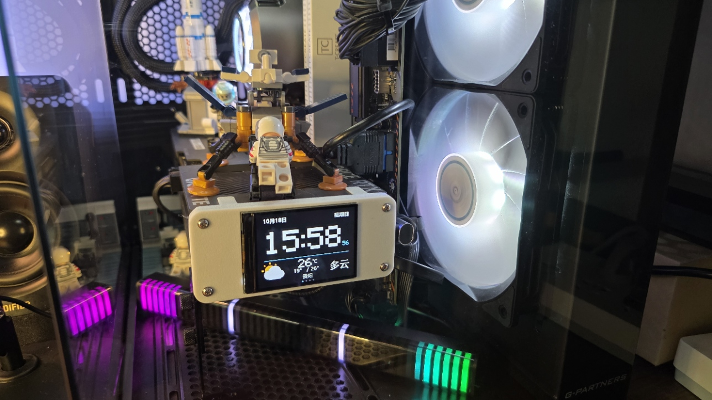
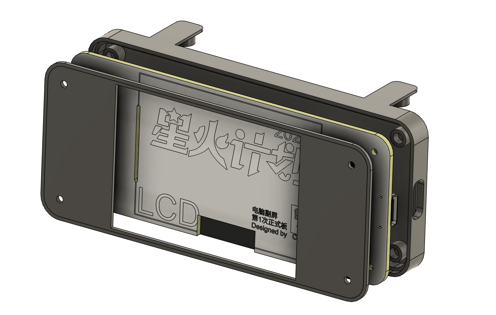

# ComputerScreen · 机箱副屏

基于 ESP32 的电脑机箱副屏项目。当前主版本使用 **ESP32-S3 + ST7789 彩屏 + ESP-IDF**，显示中文时间、日期、天气实况与逐日预报，支持手机配网、分时亮度和网页 OTA 升级。



## 两代硬件

| 版本 | 硬件与环境 | 功能及入口 |
| --- | --- | --- |
| 当前版本 3.3.0-ota | ESP32-S3-WROOM-1-N16R8、320×240 横屏、ESP-IDF v6.1 | 中文天气时钟、网页设置、分时亮度、Wi-Fi OTA；源码见 [firmware](firmware/) |
| 旧版 2.8 / 2.91 / 2.92 | ESP32、2.42 寸 OLED、Arduino | AIDA64 的 CPU / RAM / GPU 监控及关机时钟；[原使用说明](docs/legacy-oled.md) |

旧版 Arduino 源码仍保留在根目录。两代硬件的驱动、接线和升级文件不同；旧版 AIDA64 监控功能尚未迁移到当前 ESP-IDF 固件。

## 当前功能

- 纯黑背景、大号 24 小时时间；日期靠左、星期靠右，秒数位于分钟右侧。
- 下方左右对称布局：左侧大天气图标，右侧中文天气，中间显示温度、城市和预报日期；不绘制方框。
- 心知天气 HTTPS 实况及逐日预报，自动轮播、失败重试与缓存；支持中国大陆城市。
- 配网页面扫描 2.4 GHz Wi-Fi，支持中文 SSID；内置省市下拉选择，减少输入。
- 手机网页修改城市、天气私钥、时段和亮度，网络连接失败后自动开放设置热点，无需拆机按键。
- 日常和夜间亮度独立设置，按时段渐变；默认日常 25%、夜间 8%。
- 网页 OTA：上传应用固件、校验完整性、写入备用分区，再重启切换。新版本首次启动未确认前中断，可回退到可启动版本。

## 硬件与接线

主控为 ESP32-S3-WROOM-1-N16R8（16 MB Flash、8 MB Octal PSRAM），屏幕采用 ST7789，240×320 竖屏面板按 320×240 横向显示。

| 屏幕信号 | ESP32-S3 GPIO |
| --- | --- |
| MOSI | 11 |
| SCLK | 12 |
| CS | 10 |
| DC | 13 |
| RST | 14 |
| 背光控制 | 21，经 SS8050 |

实际方向、镜像和颜色配置见 [board.h](firmware/main/board.h)。本板屏幕连接器编号与规格书顺序存在反向关系，应结合网表和实物核对信号，不应只按排线序号照接。

- [硬件网表、BOM 和屏幕规格书](hardware/)
- [V2 外壳 STEP 模型](hardware/enclosure/)



## 首次使用

1. 首次安装固件并上电后，屏幕显示设置热点 `CaseScreen-XXXX` 及对应密码。
2. 手机连接热点，在浏览器打开 `http://192.168.4.1/`。
3. 扫描并选择 2.4 GHz Wi-Fi，选择省份和城市，填入自己的心知天气 **API 私钥**，保存并重启。
4. 设备联网后自动校时和获取天气。以后让手机与副屏连接同一网络，访问 `http://casescreen.local/` 修改设置。

域名无法解析时，可在路由器设备列表里查找 `casescreen` 的 IP。若电脑和副屏处于不同网段，可重新上电，让电脑连接副屏的设置热点后使用 `192.168.4.1`。热点在联网且没有客户端约五分钟后关闭；连接失败时会自动恢复。

Wi-Fi 密码和天气私钥保存于设备，不写入源码，也不会在设置页回显。保留同一 Wi-Fi 时密码留空即可；天气私钥留空保留已有值。首次冷启动需要联网校时，板上没有电池 RTC。

## 固件下载与更新

当前版本：**3.3.0-ota**。

- [下载 OTA 应用固件](firmware/release/case_display-3.3.0-ota.bin)
- [文件大小及 SHA-256 清单](firmware/release/case_display-3.3.0-ota.bin.json)
- [首次 USB 安装文件与说明](firmware/release/README.md)
- [无线升级使用说明](firmware/OTA.md)

已经安装本项目 OTA 版本时，在设置页的“固件升级”中选择上述 `.bin` 文件，上传后等待校验和自动重启。配置会保留，不需要拆机连接 USB。上传中断或镜像校验失败时，原版本仍可使用。

OTA 仅更新应用，后续保持当前分区布局。不要把完整烧录镜像、引导程序或分区表当作 OTA 文件上传。

## 从源码构建

安装并启用 **ESP-IDF v6.1**，在其命令行环境运行。Windows 建议将仓库放在不含中文的路径，例如 `D:\esp\computerscreen`。

```sh
cd firmware
idf.py set-target esp32s3
idf.py build
```

首次安装 OTA 分区布局时，通过 USB 执行 `idf.py -p <串口> flash`。已有 OTA 版本后，日常更新上传构建生成的 `build/case_display.bin` 即可。

仓库还保留了本地 Windows 工具链脚本 `firmware/idf-local.ps1`；它针对 `C:\esp\v6.1\esp-idf` 和 `C:\Espressif\tools` 的安装路径，将源码同步到 ASCII 临时目录再构建，并输出命名后的 OTA 文件至 `firmware/release/`。其他安装位置可直接使用 ESP-IDF 的标准命令。

修改版本时更新 `firmware/CMakeLists.txt` 中的 `PROJECT_VER`，保留 `-ota` 后缀。城市表和字库数据已包含在仓库中，正常编译无需重新生成。

运行主机侧检查：

```sh
cd firmware
node tests/setup.test.cjs
node tests/ota.test.cjs
python tests/test_release.py
```

## 验证范围

当前固件已完成 ESP-IDF 编译及实机 Wi-Fi OTA、上传中断、损坏文件拒绝、首次启动中断回退、分时亮度设置与恢复测试。实况和三天预报的新布局已实拍核对。尚未完成整夜运行或所有天气条件的实机遍历。

## 更新记录

新版对外统一使用 **3.x** 编号，当前为 **3.3**（固件标识 `3.3.0-ota`）；此前 1.x 为开发阶段编号。

- **3.3.0-ota**：统一新版正式编号，包含网页 OTA、分时亮度、大天气图标和对称中文布局。
- **1.2.0-ota**：夜间独立亮度、缓慢渐变及旧配置兼容。
- **1.1.0-ota**：网页升级、基础应用与双 OTA 分区、首次启动确认与回退。
- **旧版 2.92**：Arduino + OLED，修复时钟准确度；历史记录见[旧版说明](docs/legacy-oled.md)。

[早期外观一](docs/images/case-screen-early-1.jpg) · [早期外观二](docs/images/case-screen-early-2.jpg)
